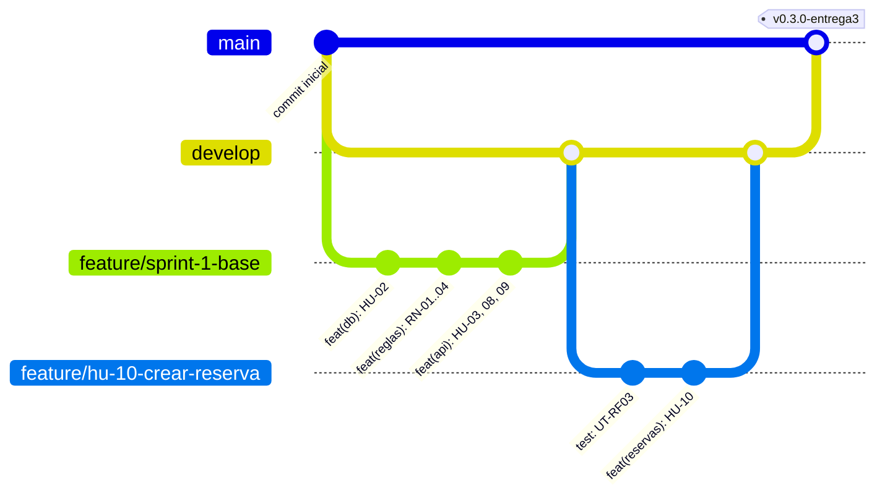

# Flujo de Git — ViajaYa

Guía práctica para trabajar el repositorio con ramas, commits, push y pull requests en GitHub. Los comandos son para **PowerShell** o la terminal de VS Code en Windows.

## 1. Modelo de ramas



| Rama | Vive | Recibe cambios de | Se despliega |
|---|---|---|---|
| `main` | Siempre | `develop` (pull request de "release") | Sí, Render despliega cada push a `main` |
| `develop` | Siempre | `feature/*` y `fix/*` (pull request) | No |
| `feature/hu-xx-nombre` | Mientras dura la historia | Sus propios commits | No |
| `fix/descripcion` | Mientras dura la corrección | Sus propios commits | No |

**Reglas:**
- Nadie programa directamente en `main` ni en `develop`.
- Una historia del backlog es una rama `feature/`.
- Cada entrega del curso es una fusión `develop → main` con un **tag**.

---

## 2. Configuración inicial (una sola vez)

```powershell
# Identidad que aparecerá en cada commit
git config --global user.name "Johan Dávila Moya"
git config --global user.email "54687684+JohanD20@users.noreply.github.com"  # correo noreply de GitHub: liga los commits a su perfil sin exponer su correo
git config --global init.defaultBranch main
git config --global pull.rebase false

# Clonar FUERA de OneDrive (OneDrive y node_modules no se llevan bien)
mkdir C:\dev
cd C:\dev
git clone https://github.com/JohanD20/viajaya.git
cd viajaya
git switch develop
npm install
```

Después copie su `backend\.env` (que no está en el repositorio) a `C:\dev\viajaya\backend\.env`.

### Protección de ramas en GitHub

En Settings > Branches > Add branch ruleset, cree una regla para `main` y otra para `develop`:
- **Require a pull request before merging.** Aprobaciones requeridas: 0 (GitHub no deja que el autor apruebe su propio pull request).
- **Require status checks to pass:** elija el job `verificar` de GitHub Actions.
- **Block force pushes.**

---

## 3. Ciclo de trabajo por historia (el día a día)

Ejemplo con HU-10, crear reserva:

```powershell
# 1. Partir de develop actualizado
git switch develop
git pull

# 2. Crear la rama de la historia
git switch -c feature/hu-10-crear-reserva

# 3. Programar y hacer commits pequeños, uno por paso con sentido
git status                                   # ¿qué cambió?
git add backend/test/services/rf03-crear-reserva.test.ts
git commit -m "test(reservas): HU-10 pruebas UT-RF03-a y UT-RF03-b"

git add backend/src
git commit -m "feat(reservas): HU-10 crear reserva con bloqueo del destino (RN-01)"

# 4. Verificar antes de subir
npm test
npm run typecheck

# 5. Subir la rama a GitHub (la primera vez con -u)
git push -u origin feature/hu-10-crear-reserva
```

6. En GitHub: **Compare & pull request**, con base `develop` ← compare `feature/hu-10-crear-reserva`.
   - Título: `HU-10 · Crear reserva con cupo transaccional y pago simulado`.
   - Descripción: casos de uso (CU-03, CU-17, CU-19, CU-20), pruebas agregadas y lista de la definición de terminado.
   - Espere a que GitHub Actions esté en verde y luego **Merge pull request**, usando la opción "Create a merge commit" para que el historial muestre la rama.

```powershell
# 7. Volver a develop y borrar la rama local
git switch develop
git pull
git branch -d feature/hu-10-crear-reserva
```

---

## 4. Mensajes de commit

Formato: `tipo(área): HU-xx descripción en presente`

| Tipo | Cuándo | Ejemplo |
|---|---|---|
| `feat` | Funcionalidad nueva | `feat(destinos): HU-04 crear destino (CU-08)` |
| `fix` | Corrige un defecto | `fix(reservas): RN-02 rechazar exactamente 48 horas` |
| `test` | Solo pruebas | `test(reglas): UT-RN01-b cupo insuficiente` |
| `docs` | Documentación | `docs: guía de despliegue en Render` |
| `refactor` | Mejora sin cambiar comportamiento | `refactor(api): extraer presentadores` |
| `chore` | Configuración, dependencias | `chore: actualizar dependencias` |
| `ci` | GitHub Actions, Render | `ci: verificar lint en pull requests` |

- Un commit = un cambio con sentido. Evite "cambios varios" o "avance".
- Nunca haga commit de `.env`, `node_modules` ni `dist` (el `.gitignore` ya los excluye).

---

## 5. Publicar una entrega (develop → main + tag)

```powershell
git switch develop
git pull
npm test                                      # todo en verde
```

1. En GitHub, abra un pull request con base `main` ← compare `develop`, titulado `Entrega 3 · Construcción`. Fusiónelo.
2. Render despliega `main` automáticamente.
3. Marque la versión:

```powershell
git switch main
git pull
git tag -a v0.3.0-entrega3 -m "Entrega 3: código fuente y pruebas unitarias"
git push origin v0.3.0-entrega3
git switch develop
```

Tags previstos:

| Tag | Hito |
|---|---|
| `v0.1.0` | Base del Sprint 1 |
| `v0.3.0-entrega3` | Entrega 3, 03/11 |
| `v1.0.0-entrega4` | Entrega 4 y defensa, 17–18/11 |

---

## 6. Mostrarle el trabajo al profesor

```powershell
git log --oneline --graph --decorate --all     # árbol de ramas y fusiones
git log --oneline develop..feature/hu-10-crear-reserva   # commits de una historia
git tag -n                                     # entregas marcadas
git show --stat HEAD                           # qué cambió en el último commit
```

En GitHub:
- Insights > Network muestra el gráfico de ramas.
- La pestaña Pull requests > Closed muestra una historia por pull request.
- La pestaña Actions muestra las pruebas automáticas de cada cambio.

---

## 7. Problemas comunes

| Situación | Solución |
|---|---|
| Programé en `develop` sin crear rama (aún sin commit) | `git switch -c feature/hu-xx-nombre`. Los cambios se mueven a la rama nueva. |
| Hice commit en la rama equivocada (sin push) | `git switch -c feature/hu-xx-nombre`, luego `git switch develop` y `git reset --hard origin/develop`. |
| Quiero corregir el mensaje del último commit (sin push) | `git commit --amend -m "mensaje nuevo"` |
| Deshacer el último commit pero conservar los cambios | `git reset --soft HEAD~1` |
| Conflicto al fusionar | Abra los archivos marcados con `<<<<<<<`, deje la versión correcta, y luego `git add <archivo>` y `git commit`. |
| `develop` avanzó mientras trabajaba en mi rama | `git switch feature/...`, luego `git merge develop` y resolver si hay conflictos. |
| Subí un secreto por error | **Rote el secreto de inmediato** (Supabase: `ALTER ROLE viajaya_api PASSWORD …`; JWT: genere uno nuevo en Render). Borrarlo del historial no basta (S-01, R-07). |
